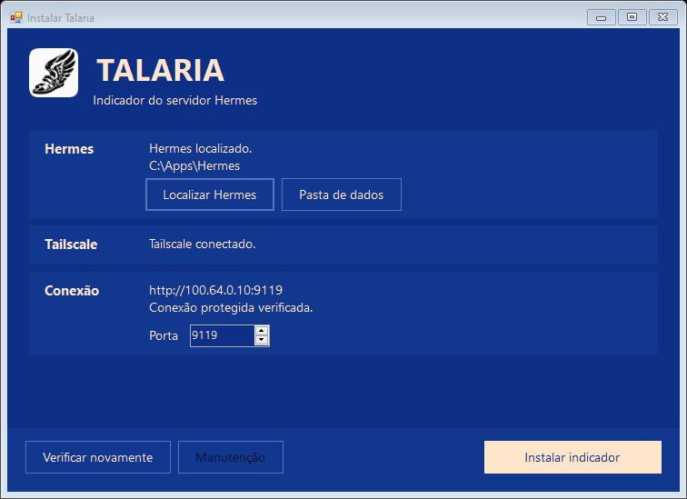
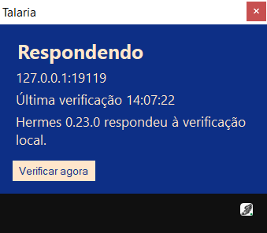

# Talaria

**A Hermes auto-server**

<p align="center">
  
</p>

Talaria is an independent, unofficial Windows utility for **Hermes AI Agent by Nous Research**.

[Official Hermes website](https://hermes-agent.nousresearch.com/) · [Download Talaria](https://github.com/enzolfernandes/talaria/releases/latest) · [Leia em português](README.pt-BR.md)

## Objective

Make it easier to use multiple connectors with a single Hermes gateway day to day.

Talaria runs on the computer hosting Hermes and shows the server's status in the Windows notification area. It can reuse an authenticated server or configure `hermes serve` to start silently when you sign in.

## Install

1. Use Windows 10 or 11 x64 and sign in to the account that runs Hermes.
2. Download `Talaria-Setup.exe` and optionally verify it against the SHA-256 checksum provided with the release. [Latest release](https://github.com/enzolfernandes/talaria/releases/latest)
3. Open the installer. If Hermes Desktop or Tailscale is missing, use the matching **Install** action to open the official installer. If you already have a working Hermes CLI, you can build Desktop in that installation or select **Continue without Desktop**. [Hermes for Windows](https://hermes-agent.nousresearch.com/docs/user-guide/windows-native) · [Tailscale for Windows](https://tailscale.com/docs/install/windows)
4. Open Tailscale and sign in when prompted. Talaria checks for a local Tailscale address. Use **Check again** after completing an external setup or restarting Windows.
5. Configure the server if prompted. Talaria reuses a healthy authenticated server and compatible login tasks. Select **Install indicator** after the health and authentication checks pass. If Talaria creates credentials, it also signs in and ends that test session.

Click the winged sandal to see the address, status, and last check. Green means a valid health response. Yellow means Talaria is waiting or retrying. Red means three consecutive failed checks. Right-click to check now, copy the address, open logs or the installer, or exit the indicator.

**Maintenance** in the installer offers repair and removal. Removing the indicator leaves the server running. **Revert server setup** is available separately for a server created by Talaria.

## Screenshots

The installer after verifying a protected connection. The address and folder are examples.



The winged sandal in the Windows notification area and its status panel connected to a local test server.



## Local data

Talaria reuses Hermes authentication when configured. Any credentials Talaria creates are stored outside the source tree in `%LOCALAPPDATA%\HermesServidor\server\credentials.local.json`, encrypted for the current Windows account using DPAPI. Configuration is stored separately. Talaria backs up the files and scheduled task definitions it changes under `%LOCALAPPDATA%\HermesServidor\backups`.

## Build and test

Run from the repository root with Windows PowerShell 5.1 on Windows x64. The build uses the .NET Framework compiler included with Windows.

```powershell
powershell.exe -NoProfile -STA -ExecutionPolicy Bypass -File scripts/Build.ps1
powershell.exe -NoProfile -STA -ExecutionPolicy Bypass -File scripts/Test.ps1
powershell.exe -NoProfile -ExecutionPolicy Bypass -File scripts/Audit.ps1
```

The installer and checksum appear in `dist`. Run `scripts/Test.ps1 -Integration` from an interactive Windows session to exercise the installer, temporary scheduled tasks, and a simulated server and network.

## License and credits

Talaria is an independent project under the [MIT License](LICENSE). Its original winged sandal and Windows interface take visual cues from the Hermes Desktop and Hermes Setup by Nous Research. [Hermes Agent license](https://github.com/NousResearch/hermes-agent/blob/main/LICENSE) · [Hermes Setup source](https://github.com/NousResearch/hermes-agent/tree/main/apps/bootstrap-installer)
